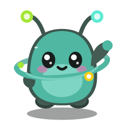

<div align="center">



# Orbi

**Seu painel para os agentes de IA, no topo da tela.**

Limites de uso de cada plano, o agente trabalhando ao vivo, um arsenal de skills e os seus projetos do GitHub, tudo numa ilha flutuante com um mascote que reage ao que os agentes fazem.

Claude Code · Codex · Antigravity · Gemini CLI — Windows

</div>

<p align="center">
  
</p>

## O que ele faz

### Limites de cada IA, sempre à vista

No topo do painel, uma pílula por plano: um anel colorido e a porcentagem usada da janela de 5 horas. Clique numa pílula para ver a janela de 5 horas e a da semana, com a hora em que cada uma renova. A cor muda para âmbar perto do limite e para vermelho no limite.

Nada é estimado: sem uma fonte de dados, a pílula mostra "—" e o cartão explica o que fazer.

### Ao vivo: acompanhe o agente trabalhando

O botão **Ao vivo** abre uma janela com cada passo do agente (ler, buscar, editar, rodar comando) e, ao lado, o arquivo que ele mexeu, centrado no trecho que acabou de mudar. Abas para trocar entre Claude Code, Codex e Antigravity. Enquanto o agente trabalha, o Orbi puxa um notebook para o colo e digita junto.

### Arsenal de Skills

<p align="center">
  
</p>

Um catálogo de Agent Skills em cartões, com busca, categorias e o filtro **Instaladas**. Abra uma skill, escolha os agentes e confira, antes de confirmar, exatamente o que será gravado e em qual pasta. Remover desfaz a instalação em um clique.

| Agente | Pasta das skills |
| --- | --- |
| Claude Code | `~/.claude/skills` |
| Codex | `~/.agents/skills` |
| Gemini CLI | `~/.gemini/skills` |
| Antigravity | `~/.gemini/config/skills` |
| Cursor | `~/.cursor/skills` |

- Cada skill do catálogo é fixada num commit, com o tamanho e o sha256 de cada arquivo; um arquivo que não bate não é gravado. Só entram skills com licença MIT ou Apache-2.0.
- O Orbi nunca executa nada de uma skill. Skills que trazem scripts pedem uma segunda confirmação.
- Uma pasta que o Orbi não instalou, ou que você editou, nunca é substituída sem você pedir; a versão anterior fica guardada.
- MCPs, CLIs e outros itens que não são pastas de skill aparecem como instalação manual, com o comando pronto para copiar.

### Projetos do GitHub

<p align="center">
  
</p>

Com o GitHub conectado, a aba de projetos mostra:

- **Meus** e **Estrelas**: os seus repositórios e os que você marcou.
- **Locais**: os projetos Git deste PC, com o estado de cada um (fora do GitHub, com alterações, para enviar, novidades no GitHub ou em dia), e os botões para publicar, enviar e trazer novidades. Antes de enviar, a lista exata do que sobe; arquivos secretos e chaves no código bloqueiam o envio.
- **De alguém**: quem você segue; um clique abre os projetos da pessoa.
- **Explorar**: o Top 10 da semana (projetos novos com mais estrelas, com filtro de linguagem) e a busca em todo o GitHub.

Abra um projeto e use **Puxar para a Área de Trabalho**: o Orbi clona com o seu Git e mostra o progresso. Ele não executa nada do projeto, e uma pasta com o mesmo nome nunca é sobrescrita.

### Permissões sem trocar de janela

Quando o Claude Code ou o Codex pede permissão, o pedido aparece na ilha: **Permitir** (`Y`), **Negar** (`N`) ou decidir no terminal. Sem resposta no tempo escolhido, a decisão volta para o terminal: o Orbi nunca permite nada sozinho.

### O mascote

O Orbi pisca, respira, balança as antenas e segue o cursor com os olhos. Fica curioso enquanto o agente pensa, concentrado enquanto executa, mostra "!" num pedido de permissão, ✓ ao terminar e fica sonolento quando um limite chega a 100%. Sem você no computador, cochila. Tem versão 2D e 3D, e "Reduzir animações" desliga todo o movimento contínuo.

## Instalar e rodar

Requer Windows 10 ou 11 e Node.js.

```bash
git clone https://github.com/joel1fps/orbi.git
cd orbi
npm install
npm start          # compila e abre o Orbi
```

Para gerar o instalador:

```bash
npm run dist       # gera dist/Orbi-Setup.exe
```

O instalador instala só para o seu usuário, sem pedir administrador, e cria atalhos na Área de Trabalho e no menu Iniciar. O executável não é assinado, então o Windows SmartScreen pode avisar na primeira execução. O Orbi fica na bandeja do Windows; `Ctrl+Alt+O` abre e recolhe o painel.

## De onde vêm os dados

| Ferramenta | Limites do plano | Atividade e Ao vivo |
| --- | --- | --- |
| **Claude Code** | Sua conta Claude (Pro ou Max), pelo login local do Claude Code, só leitura | Transcrições em `~/.claude/projects`; em tempo real depois de **Conectar** (hooks oficiais do Claude Code, com backup das suas configurações) |
| **Codex** | Registrados pelo próprio Codex em `~/.codex/sessions` | Sessões do Codex; permissões na ilha depois de **Conectar permissões** |
| **Antigravity** | API local do Antigravity aberto, cota por modelo | Sessões do Antigravity |
| **Gemini CLI** | Cota da sua conta Google, pelo login do Gemini CLI | Detecção |
| **GitHub** | — | Token pessoal, login do Git ou GitHub CLI; o token fica criptografado pelo Windows |

Privacidade:

- Os logins são só lidos, nunca gravados, exibidos ou registrados em log, e vão apenas para quem os emitiu (Anthropic e Google). Os dados do Codex e do Antigravity não saem do computador.
- O servidor local da ponte escuta só em `127.0.0.1` e exige um token aleatório por instalação.
- Conectar e desconectar mexe só no que o Orbi adicionou, sempre com backup.

## Atalhos

| Tecla | Ação |
| --- | --- |
| `Ctrl+Alt+O` | Abrir ou recolher o painel |
| `Y` / `N` | Permitir ou negar, com a ilha em foco |
| `Ctrl+Alt+Y` / `Ctrl+Alt+N` | Permitir ou negar de qualquer lugar, enquanto houver um pedido |
| `Ctrl+Alt+A` | Trazer a ilha para a frente para responder um pedido |
| `Esc` | Recolher |

## Desenvolvimento

```bash
npm run dev        # desenvolvimento, com recarga automática
npm test           # testes
npm run typecheck  # tipos
```

Electron, React, TypeScript, electron-vite, Motion e three.js.

```
src/main/       processo principal: janela, bandeja, integrações, skills, GitHub
src/preload/    API segura exposta à interface
src/renderer/   interface: ilha, painel, Ao vivo, Arsenal, GitHub e o mascote (2D e 3D)
src/shared/     tipos e utilitários
resources/      ícones, catálogo de skills e instalador
```

## Licença

[MIT](LICENSE).

<sub>As demonstrações acima usam dados fictícios.</sub>
